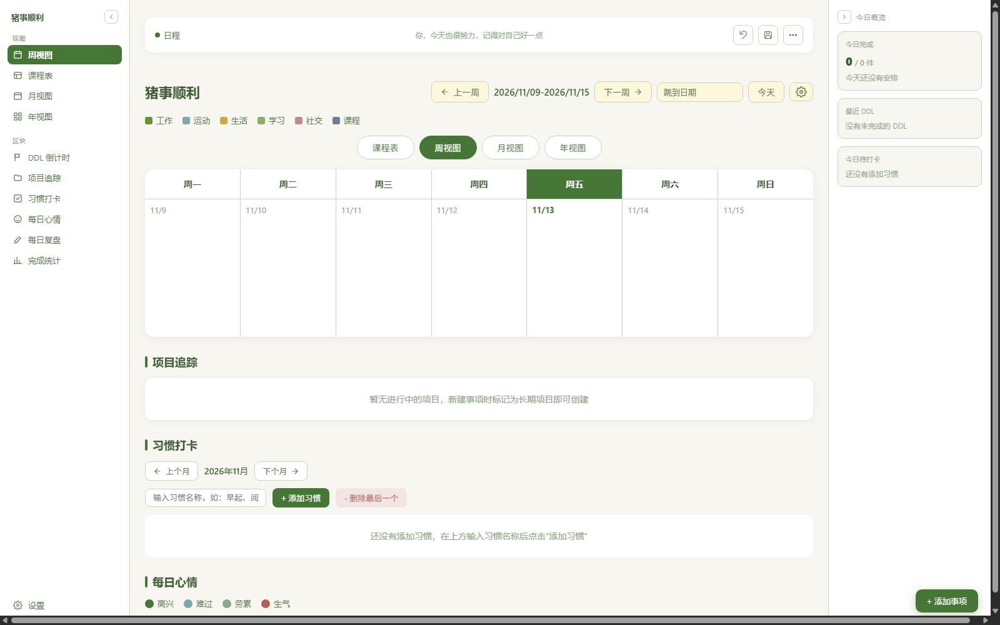

# Zhushroom Calendar（猪事顺利）

在 Obsidian 标签页里打开一个完整的日历：周 / 月 / 年视图、课程表、DDL 倒计时、习惯打卡、每日心情与每日复盘。数据直接以 Markdown 写进库里，和笔记一起同步。

日历本体是单文件页面，随插件一起打包，安装后不需要再下载任何东西。



## 使用

1. 启用插件后，左侧边栏出现小猪图标，点击即可在标签页里打开日历（也可以用命令面板的「打开猪事顺利」）
2. 第一次打开会有一个三步向导：怎么称呼你、要不要铺示例日程、数据存在哪里
3. 日程、心情、习惯打卡、复盘都写在 `日程/` 目录下，可以用 Obsidian 编辑器直接改

## 设置

| 项 | 说明 |
| :--- | :--- |
| 页面来源 | 内置页面（默认）或库里自己的单文件 html |
| 页面文件路径 | 选「库内文件」时才生效，默认 `猪事顺利.html` |
| 数据目录 | 默认 `日程`，日程 / 心情 / 习惯 / 复盘都写在这里 |
| 侧边栏图标 | 小猪或蘑菇 |

## 数据在哪

```
日程/
├── 01-每日日程/      # 每天的日程
├── 02-总结报告/      # 每日复盘
├── 07-习惯打卡/
├── 08-文艺审美/      # 每日心情
└── 09-项目追踪/
```

插件只读写这个目录，不会碰库里其他笔记。

## 网络与隐私

- 插件本身不发起任何网络请求：页面、图标、样式全部打包在 `main.js` 里，不从远端加载代码
- 内置页面里保留的「学在浙大同步」与「钉钉推送」入口在这个打包版本中被隐藏，同步函数在入口处直接返回，因此没有任何会自动触发的请求
- 数据只以 Markdown 形式写进库内数据目录，不上传、不统计、不联网校验

## 已知限制

- 仅桌面端：页面用 iframe 渲染，插件依赖电脑版 Obsidian
- 不含学在浙大（教务网）同步，这部分是独立的本地服务，不在本插件范围内
- 页面数据同时在浏览器 `localStorage` 里存一份，换设备前请用页面里的「设置 → 数据 → 导出数据」备份

## 开发

```bash
node tools/build.js <单文件页面路径>   # 把页面内联进 main.js
node --check main.js                   # 语法检查
node test/harness.js                   # 假 Obsidian 环境冒烟测试
node tools/check-manifest.js           # manifest 合规自检
node tools/check-listing.js            # 查看社区目录的审核状态与收录情况
```

`src/main.js` 是插件源码模板，`main.js` 是构建产物（提交进仓库供 Obsidian 直接下载）。

## 许可

MIT
